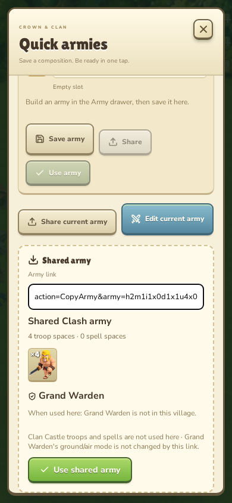

# Original-game army-code indices

Pinned client **18.400.21**, bundle `7f04bdfdc4124b1f49308423bb8f4aa8b137aae3`.
The [complete client manifest](../full-client/manifest.json) pins the source
bytes. `index.json` retains the numeric indices used by the client's shared
army links. Troops and spells use their `GlobalID` less the table base
(4,000,000 and 26,000,000). Heroes, pets and equipment use original record order.
These orders include Builder Base heroes and helper pet rows; they cannot be
replaced with this game's visible roster order.

The client [Cookbook importer](../../scripts/import-native-army-recipes.py)
already decodes this grammar offline. The runtime importer uses the same pinned
indices for pasted original-game links and raw codes. All 37 source Cookbook
codes are retained in the generated test fixture and compared with the existing
independently decoded recipe catalog, including complete hero loadouts and
Clan Castle compositions.

Sections `h`, `u` and `s` carry hero loadouts, ordinary troop/siege counts and
spell counts. `i` and `d` carry Clan Castle troops and spells. A unit entry is
`countxid`; a hero is `id[m<mode>][p<pet>][e<item>_<item>]`. Entries are separated
by hyphens. The parser bounds code length and numeric fields and rejects unknown
or unsupported roster entries, malformed/repeated sections, duplicate actors,
foreign equipment, repeated pets and oversized siege reserves. It accepts only
Warden ground/air mode values zero and one, retaining them as preview metadata.

The game applies the receiving village's own housing, unlocks and hero fallback
rules. It does not apply the imported Clan Castle roster or Warden mode: those
limitations appear before Use and in the completion message. This adds no
account, donation, research transfer or transport system. Outgoing shares retain
the separate local composition format, and save/combat versions are unchanged.
See [player controls and link boundaries](../../docs/ARMY-SHARING.md).

Rebuild and verify with the pinned native-art Python requirements installed:

```sh
python scripts/import-native-army-codes.py
python scripts/import-native-army-codes.py --check
```

The importer verifies downloaded/cached CSV bytes against the manifest before
building its index and source-code fixtures. It regenerates no art. Model checks
cover every Cookbook code, source hero order, original URLs, unsupported input,
atomic preparation and live-battle guards. Browser checks exercise phone,
landscape and desktop previews, explicit exclusions, intact village progress,
invalid-link recovery and initial navigation. Existing local sharing scenarios
exercise the shared preview boundary.


